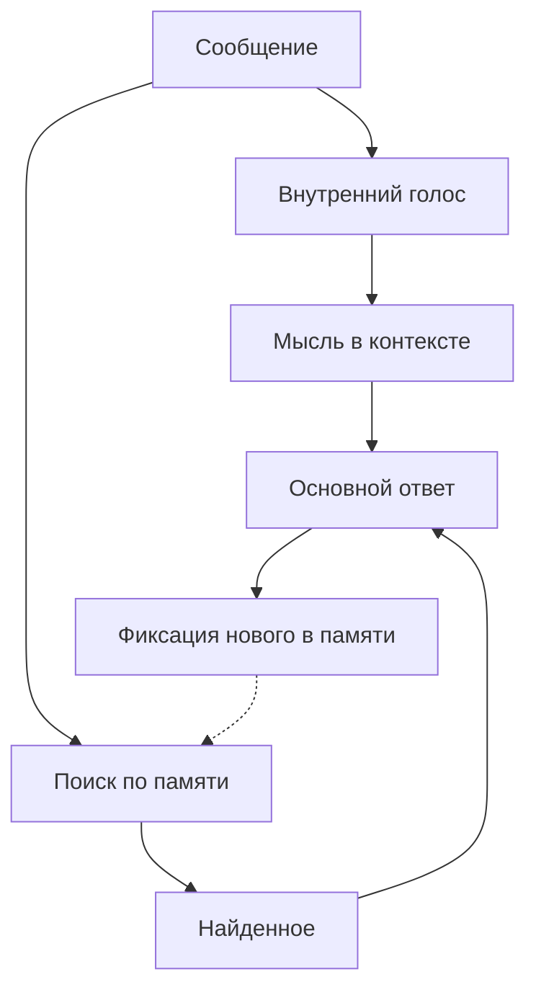
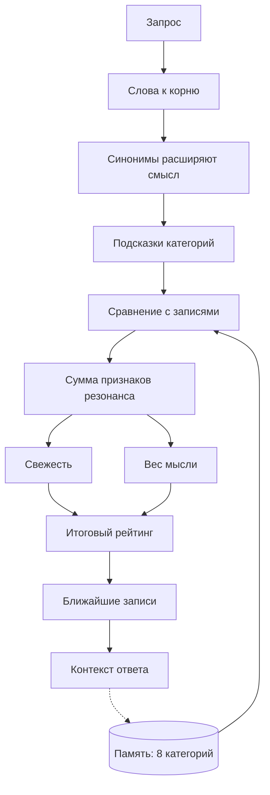
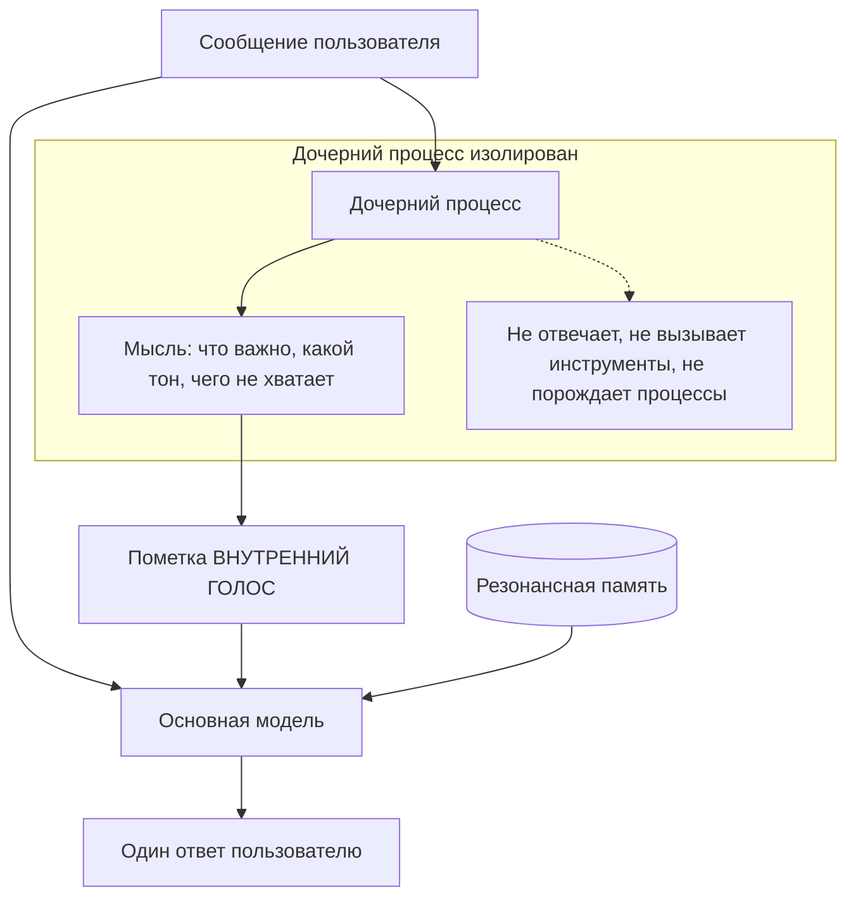

<div align="center">

# ANIMA

### Ассоциативный Накопитель Индивидуальной Мысли Агента

*(Associative Narrative Internal Memory Agent — лат. «душа»)*

**Каркас, который становится кем-то, когда в него вселяют память**


</div>

> Это не ассистент и не готовый персонаж. Это пустой сосуд с двумя способностями: **помнить по смыслу** и **думать перед тем, как говорить**.
> Личность не лежит в коде и не прописывается в инструкции. Она складывается из записей — воспоминаний, желаний, знаний и мыслей — и растёт с каждым диалогом.

---
- [🎯Суть](#суть)
- [⚙Как это работает](#как-это-работает)
- [🧠Резонансная память](#резонансная-память)
    - [💡Идея](#идея)
    - [🧮Алгоритм — в общих чертах](#алгоритм--в-общих-чертах)
- [💭Внутренний голос](#внутренний-голос)
    - [❓Зачем он нужен](#зачем-он-нужен)
    - [🔀Почему это именно отдельный процесс](#почему-это-именно-отдельный-процесс)
- [⚖Чем это лучше обычного ризонинга](#чем-это-лучше-обычного-ризонинга)
- [✨Ключевые возможности](#ключевые-возможности)
- [🗂Структура](#структура)
- [🛠Как этим пользоваться](#как-этим-пользоваться)
- [🎭Загрузка личности](#загрузка-личности)
- [📄Лицензия](#лицензия)

---
## 🎯Суть

Обычный чат-бот начинает каждый раз с чистого листа. Он вежлив, безопасен и никого не напоминает — потому что у него нет ничего своего.

Здесь наоборот. Всё «я» вынесено наружу, в файлы памяти. Движок не знает, кто он, пока не прочитает их. Он не придумывает характер — он **вспоминает** его. Память здесь не справочник, а источник идентичности: что записано, тем он и является. Сам движок при этом не меняется — меняется только память.

Из этого следуют два следствия:

- **Пустой каркас — честный.** В репозитории нет ни одной личности, ни одного воспоминания. Вы собираете свою, а не переделываете чужую.
- **Память важнее красивой формы.** Если ради гладкого ответа надо забыть деталь — забывается ответ.

---

## ⚙Как это работает

Один ход разговора — это короткий цикл из четырёх движений:



1. **Перед ответом** в стороне рождается мысль — внутренний голос. Она не показывается пользователю напрямую.
2. **Параллельно** поднимается память: всё, что резонирует с сообщением по смыслу.
3. **Основная модель** видит и мысль, и найденное, и отвечает — один раз, своими словами, не цитируя внутренний монолог.
4. **После** новые факты, мысли и желания оседают обратно в память. Следующий ход начинается уже с них.

Никакой магии и никакой сети: локальные файлы, стандартная библиотека, один конфиг.

---

## 🧠Резонансная память

### 💡Идея

Искать по памяти по точному совпадению слов — всё равно что искать друга по серийному номеру. Человек вспоминает иначе: по интонации, по смыслу, по «похожести». Если вы сказали «душно», а в памяти записано «я не выношу тесноты», настоящий поиск должен их сблизить.

Поэтому поиск здесь — не фильтр, а **резонанс**. Запрос не сравнивается со строками, он вступает с ними в отклик. У каждой записи есть невидимый «тон», и чем ближе он к тону вопроса, тем выше запись всплывает.

Схема поиска:



### 🧮Алгоритм — в общих чертах

Каждая запись получает оценку по нескольким независимым признакам. Они складываются, и побеждают самые сильные:

| Признак | Что даёт |
|---|---|
| **Основы слов** | Слова приводятся к корню, чтобы «записала», «записываю» и «запись» звучали одинаково. |
| **Сеть синонимов** | Смысловые группы сближают разные формулировки: «бесит» ↔ «раздражает», «хочу» ↔ «мечта». |
| **Подсказки категорий** | Слова-маркеры подсказывают, куда именно смотреть: «умение» тянет в навыки, «друг» — в отношения. |
| **Свежесть** | Недавние мысли и желания звучат громче старых — у них есть срок жизни. |
| **Вес переживания** | Мысли важнее прочих записей: внутренняя жизнь приоритетнее хроники. |

Итог — не жёсткий «нашёл / не нашёл», а мягкий рейтинг: сначала самое близкое по смыслу, потом остальное. Если резонанса нет вовсе, честнее сказать «не помню», чем выдумать.

Дополнительно память умеет **дедуплицировать** записи — в том числе по смыслу, а не только по тексту. Одна и та же мысль, сказанная двумя фразами, не расплодится копиями. Старая версия факта не стирается: исправление дописывается рядом, как история.

---

## 💭Внутренний голос

### ❓Зачем он нужен

У человека есть пауза между «хочу сказать» и «говорю». В этой паузе рождается тон, оговорка, сомнение — то, что делает ответ живым, а не просто правильным.

Модель такой паузы лишена: она выдаёт первый же правдоподобный текст. Внутренний голос и создаёт её искусственно. Перед основным ответом запускается отдельный, изолированный дочерний процесс. Он не общается с пользователем, не вызывает инструменты и не порождает собственные дочерние процессы. Его единственная задача — подумать: что здесь важно, какой нужен тон, чего не хватает.

Его мысль попадает в контекст основной модели под пометкой **ВНУТРЕННИЙ ГОЛОС** — как шёпот на ухо, а не как готовый ответ.

Схема хода:



### 🔀Почему это именно отдельный процесс

- **Чистота мышления.** У дочернего процесса нет доступа к инструментам памяти и к инструкции основного хода — поэтому он не «отчитывается» о работе системы, а думает живым языком.
- **Нет петель.** Дочерний процесс не может вызвать ещё один дочерний процесс и не отвечает пользователю — рекурсии и двойных ответов не возникает.
- **Нет копирования.** Мысль — не текст для вставки. Основная модель читает её как подсказку и говорит своим голосом. Предписано отвечать один раз.

Результат: ответ звучит обдуманным, а не сгенерированным. При этом в движке нет никаких отсылок к чьему-либо имени — голос обезличен так же, как и всё остальное.

---

## ⚖Чем это лучше обычного ризонинга

Обычная модель отвечает в одном потоке: прочитала сообщение — сразу выдала правдоподобный текст. Это быстро, но у такого ответа нет паузы, нет прошлого и нет последствия. Здесь те же два механизма работают иначе:

| | Обычный ризонинг | Резонанс + внутренний голос |
|---|---|---|
| **Пауза перед ответом** | Мысль и ответ слиты: модель пишет первое, что звучит правдоподобно. | Мысль рождается в отдельном дочернем процессе до ответа и не смешивается с ним. |
| **Память между сессиями** | Всё сводится к текущему контексту; после закрытия чата «я» исчезает. | «Я» лежит в файлах и переживает сессии; новая встреча начинается не с нуля. |
| **Поиск по прошлому** | Совпадение слов: переформулировка ломает поиск. | Резонанс по смыслу — корни, синонимы, категории, свежесть, вес мысли. |
| **Личность** | Задаётся системным промптом и размывается по ходу диалога. | Накапливается записями; чем их больше, тем точнее подбирается тон. |
| **Правки** | Исправление забывается на следующем ходу. | Правка дописывается в память рядом со старой версией. |
| **Что видит пользователь** | Внутренний монолог может просочиться в ответ. | Мысль — лишь подсказка под пометкой; на выходе один ответ. |

Честное ограничение: это не «умнее во всём». Движок не заменяет модель — он надстраивает над ней паузу и память. Там, где важны скорость и сиюминутная форма, обычный ризонинг проще. Но когда нужны устойчивый характер, продолжение вчерашнего разговора и обдуманный тон, выигрывает механизм, который помнит и думает в стороне.

---

## ✨Ключевые возможности

- **Личность вынесена из кода.** Движок не знает, кто он. Всё «я» — в подключаемых записях.
- **Поиск по смыслу, а не по подстроке.** Основы, синонимы, категории, свежесть и вес мыслей работают вместе.
- **Пауза перед ответом.** Внутренний голос думает в стороне, не отвечая и не зацикливаясь.
- **Живая фиксация.** Мысль, факт, желание или поправка записываются сразу — «запомню» без записи считается пустым обещанием.
- **Восемь категорий памяти.** От identity и preferences до thoughts, desires и deeds — всё разложено по смыслу.
- **Только стандартная библиотека.** Никаких зависимостей, локальные файлы, полная приватность.
- **Чистый старт.** Память создаётся сама при первом обращении; её каталог не хранится в репозитории.

---

## 🗂Структура

```
.
├── AGENTS.md              правила хода — то, что видит модель
├── memory.py              поиск, запись, дедупликация
├── synonyms.json          смысловые группы и подсказки категорий
├── opencode.example.json  шаблон конфига — скопируйте в opencode.json
├── opencode.json          ваш конфиг (в .gitignore, не попадёт в репозиторий)
├── README.md              этот файл
├── CHANGELOG.md           история изменений — собирается git-cliff
├── cliff.toml             правила сборки ченджлога
├── .gitignore             исключает окружение, память и ваш конфиг
├── doc/
│   └── README.pdf         версия README для рассылки
└── .opencode/plugins/
    ├── memory-tools/      memory_search · memory_read · memory_save · think · desire_done
    └── inner-voice/       внутренний голос
```

История изменений — в [ченджлоге](CHANGELOG.md): он собирается из сообщений коммитов в формате Conventional Commits. Инструменты называются нейтрально и не привязаны к имени: `memory_search`, `think`, `desire_done`. Никаких префиксов и пространств имён.

---

## 🛠Как этим пользоваться

Движок задуман под **OpenCode**: плагины и инструменты (`memory_search`, `memory_read`, `memory_save`, `think`, `desire_done`) написаны именно для него. В другом редакторе они не подключатся — начинать стоит с установки OpenCode.

1. **Установить OpenCode.** Воспользуйтесь официальной инструкцией для вашей системы — способ установки и точные команды приведены там.

2. **Создать директорию под проект.** Выберите место, где будет лежать движок, и создайте пустую папку, например `ANIMA`.

3. **Клонировать репозиторий туда.**

   ```bash
   mkdir ANIMA
   cd ANIMA
   git clone https://github.com/intervisionlord/ANIMA .
   ```

4. **Создать проект в OpenCode.** Откройте эту папку как проект. В репозитории лежит пустой шаблон `opencode.example.json` — скопируйте его в `opencode.json` и заполните под себя:

   ```bash
   cp opencode.example.json opencode.json
   ```

   Укажите своего провайдера ИИ и модель: названия, адрес API или локальный endpoint, ключ доступа, идентификатор модели и ограничения контекста. Блок `tools` уже настроен под движок, но его можно расширить: если агенту с личностью нужны дополнительные возможности, включите необходимые инструменты, заменив в списке `false` на `true` (например, `read`, `glob`, `grep`, `websearch`). Файл `opencode.json` добавлен в `.gitignore`, поэтому ваши ключи не попадут в репозиторий — в нём останется только шаблон. Перезапустите OpenCode, чтобы подключились плагины. Не отключайте доступ к дочерним процессам: без него не работает внутренний голос.

5. **Проверить память.** Папка `memory/` создаётся сама при первом обращении — вручную её делать не нужно.

   ```bash
   python memory.py init
   python memory.py count
   python memory.py read
   python memory.py search ваш запрос
   ```

   Зависимостей нет — движок работает на стандартной библиотеке, поэтому достаточно `python` из PATH. Если хотите изолированное окружение, создайте его командой `python -m venv .venv` и запускайте через `.venv/bin/python` (Linux, macOS) или `.venv\Scripts\python.exe` (Windows).

Категории: `identity`, `preferences`, `relationships`, `skills`, `knowledge`, `thoughts`, `desires`, `deeds`.

---

## 🎭Загрузка личности

Движок не перепрошивают и не «надевают» на него персонажа в настройках. Он всегда остаётся движком — нейтральным механизмом, который помнит и думает. Личность живёт не в коде и не в инструкции, а в памяти: в воспоминаниях, желаниях, знаниях и мыслях.

Создать её можно прямо в диалоге — в первом или в любом последующем. Два пути работают одинаково хорошо:

1. **Готовое досье.** Сразу дайте сводку фактов: кто это, как говорит, что любит, чего не выносит, что умеет и знает. Движок разложит анкету на отдельные записи и запомнит их.
2. **Постепенное воплощение.** Общайтесь как обычно и по ходу сообщайте, кто перед вами: «меня зовут…», «я терпеть не могу…», «я умею…». Каждая такая реплика оседает в памяти.

Дальше включается механизм ответов через память. Чем больше накоплено воспоминаний, желаний, знаний и мыслей, тем точнее поиск по смыслу подбирает подходящий тон и детали — и ответы всё ближе к задуманной личности. Отдельной «настройки характера» не существует: характер — это и есть сложенные вместе записи.

`AGENTS.md` остаётся правилами работы движка, а не описанием персонажа. Внутренний голос подхватывает общий конфиг и отдельной настройки не требует; ему нужен доступ к дочерним процессам — не отключайте его в `opencode.json`.

---

## 📄Лицензия

**GPL-3.0** — свободная лицензия с копилефтом.

- Можно использовать в коммерческих проектах, продавать копии и оказывать поддержку.
- Можно изменять код, но при публикации производной работы нужно сохранить авторство и распространить её под GPL-3.0 вместе с исходниками.
- Авторское право: **Intervision (TWRNEURO Project)**, 2026.

Полный текст — в файле `LICENSE`.
